# Checklisty paczek — ergonomia edycji, kompletowania i etykiet

Data: 2026-11-09. Zakres: lokalny interfejs generatora, bez publikacji wydania.

## 1. Stan repozytorium przed pracami

- Branch: `main`.
- Lokalny HEAD: `45f40d6b323ffb0ee1ff54e051aa993a94d81766`.
- Lokalnie zapisany `origin/main`: `7cc9e56a396f5a1b6f8c9041cb97e1f26956182c`.
- Katalog roboczy czysty; `main` dwa commity przed lokalnym `origin/main`.
- Nie wykonywano fetch, połączenia z GitHub, zmiany gałęzi ani operacji na historii. Zastosowano wyjątek z polecenia: zasady repozytorium wymagają pracy w bieżącym środowisku bez automatycznego tworzenia gałęzi.
- Nie stwierdzono niezwiązanych zmian roboczych na początku zadania. Nie utworzono commita ani wydania.

## 2. Audyt i mapa komponentów

Przed implementacją uruchomiono lokalny serwer demonstracyjny i wykonano trzy zrzuty w osobnym profilu Chrome. Dane użytkownika nie były używane ani modyfikowane. Python preflight umiejętności Product Design nie uruchomił się z powodu niedostępnego aliasu systemowego; osobny odczyt potwierdził brak zapisanego `user-context.md`. Projekt i aktualne repozytorium stanowiły źródło kontekstu.

| Przepływ | Istniejące komponenty i mechanizmy | Ustalenie audytu |
|---|---|---|
| Edycja | `WidokChecklistPaczek`, `Paczki`, `Pozycja`, `InformacjaDyspozycji` | Nazwa i ilość dzieliły miejsce z przyciskiem usunięcia, a kolejność i szczegóły zajmowały kolejny rząd. Dane logistyczne wydłużały dojście do materiałów. |
| Kompletowanie | `PanelKompletowania`, `PozycjaKompletowania`, `WeryfikacjaZdjeciaPaczki` | Powtórzony kontekst szkolenia, wysokie karty, osobny szeroki obszar potwierdzenia pod liczeniem. |
| Etykiety | `PanelEtykietPaczek`, `Etykieta`, `modelEtykietyPaczki` | Konfiguracja i podgląd ułożone pionowo, powtarzane etykiety pól korekt, wszystkie paczki widoczne w ciągu pod formularzem. |
| Układ i podgląd | `UkladFormularzaIPodgladu`, `PanelGeneratoraDokumentu`, `Druk` | Wspólny układ już istniał. Brak lokalnych narzędzi skali dla tych dwóch podglądów; po przewinięciu formularza podgląd pozostawiał pustą prawą kolumnę. |
| Zapis | `rejestrChecklistPaczek`, wspólny rejestr, `useStanDokumentu` | To obecne źródło prawdy. Nie ma potrzeby nowego magazynu ani migracji. |
| Wydruki | `AkcjeEksportuPdf`, `zmierzScenePdf`, renderer PDF, `kodQrEtykiety` | Istniejący eksport obsługuje skalowane drzewo dokumentu. Można przebudować jego otoczenie bez zmiany generatora. |

Przed zmianami przedstawiono mapę i zakres prac w rozmowie. Nie przeprowadzano ogólnego refaktoringu architektury.

## 3. Porównanie trzech etapów

### 1. Edycja checklisty — poprawiona gęstość i dostępność operacji

Przed: materiał zajmował około 90 px wysokości w referencyjnym oknie 1440×900. Przyciski kolejności i szczegóły zajmowały osobny rząd, a ilość wymagana była schowana w szczegółach.

Po: zwykły materiał zajmuje około 40 px. Tabela ma kolumny nazwy, ilości wymaganej, przygotowanej, stanu i akcji. Puste ręczne nadpisanie nadal pozostaje `null`; pole pokazuje ilość wyliczoną jako podpowiedź. Zachowano osobne pole ilości przygotowanej.

Kategorie mają liczniki, zwijanie oraz dodawanie do konkretnej kategorii. Materiały przenosi się uchwytem, skrótem Alt+strzałka albo przyciskami w menu. Przenoszenie pozostaje ograniczone do tej samej paczki i kategorii oraz korzysta z istniejącej operacji modelu. Nie zmienia identyfikatorów.

Szczegóły są domyślnie zamknięte. Potrzeba potwierdzenia ilości, konflikt i niepewna dyspozycja pozostają widoczne przy nazwie. Dane logistyczne są rozwijane. Materiały znajdują się przed formularzami opisowymi, a dane szkolenia i odbiorcy korzystają z dwóch kolumn, gdy jest miejsce.

| Przed | Po — lista materiałów |
|---|---|
| 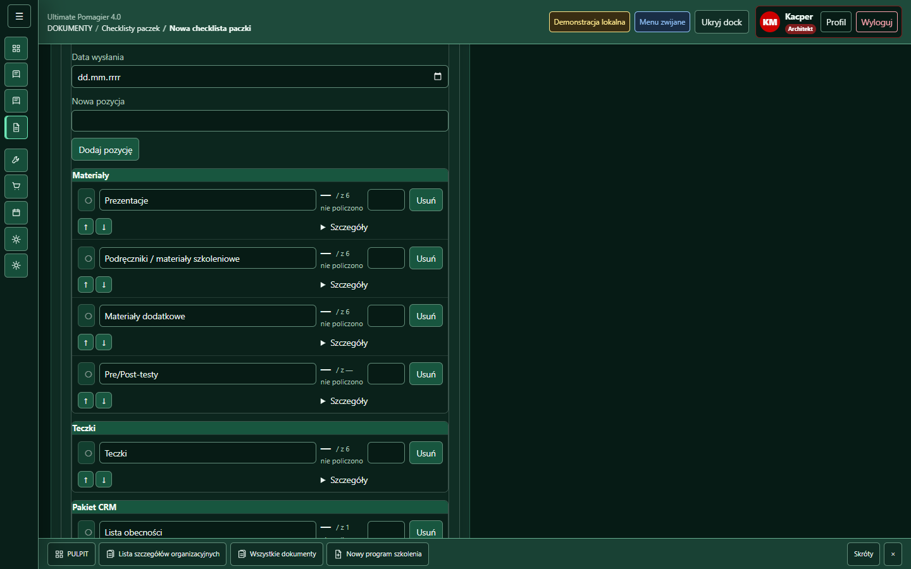 | 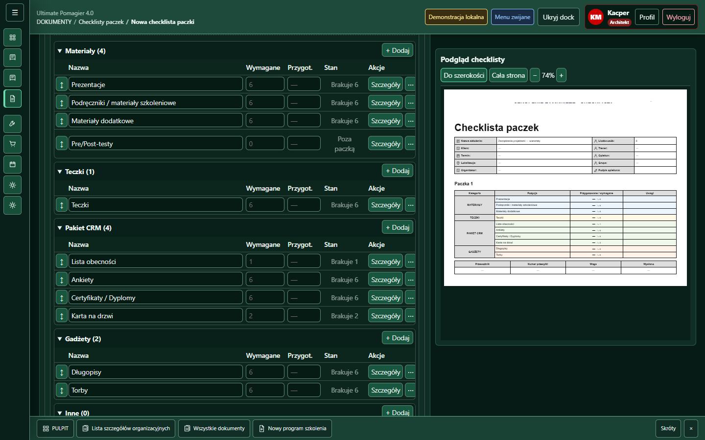 |

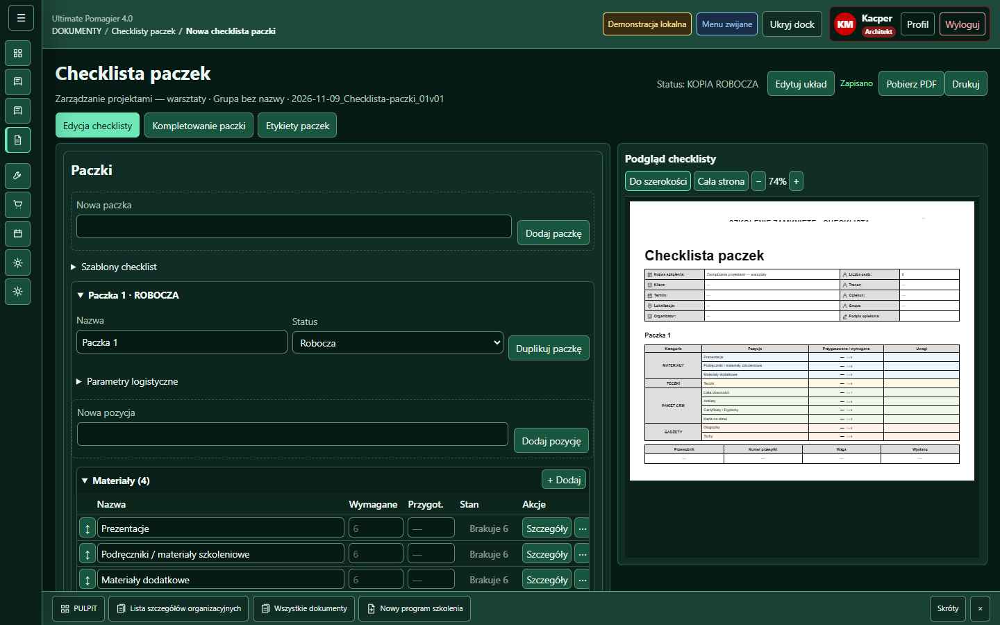

### 2. Kompletowanie — poprawiona czytelność postępu i liczenia

Przed: pierwszy materiał zajmował około 160 px; liczenie i pełne potwierdzenie były rozdzielone pionowo.

Po: typowy materiał zajmuje około 70 px w tym samym oknie. W szerokim panelu nazwa, wymagana ilość, liczenie i stan stoją obok siebie. W węższym panelu powstają dwa zwarte rzędy. Potwierdzenie pozostaje jawną operacją i nadal wymaga policzonego kompletu oraz wcześniejszej weryfikacji ilości z importu.

Nagłówek pokazuje nazwę paczki, liczbę kompletnych pozycji, procent, pasek postępu i status. Kontekst szkolenia przeniesiono do wspólnego nagłówka. Zachowano zdjęcie paczki, kontrolę uprawnień, historię oraz niezależność paczek.

| Przed | Po |
|---|---|
| 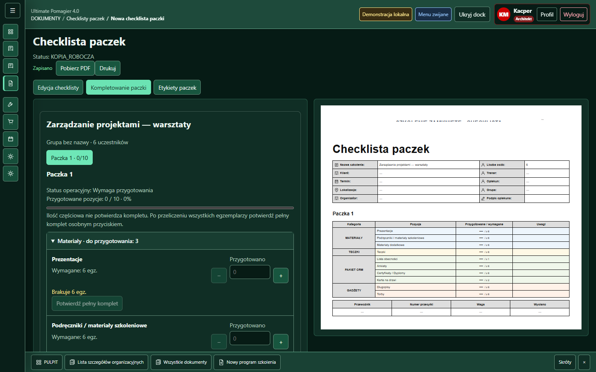 | 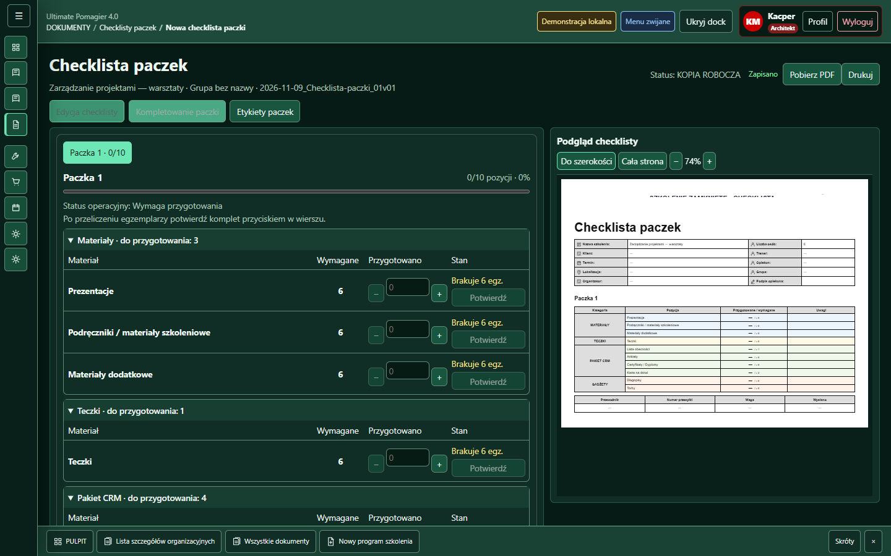 |

### 3. Etykiety — poprawiony układ konfiguracji, korekt i podglądu

Paczka, tryb druku i format są w jednym wierszu na szerokim ekranie. Eksport ma osobną grupę. Korekty materiałów korzystają z tabeli nazwa–ilość; nadal zapisują się dotychczasowym mechanizmem korekt po opuszczeniu pola i nie zmieniają źródłowych materiałów.

Po prawej wyświetla się wybrana etykieta. Pozostałe strony pozostają mierzalne poza obszarem widocznym dla istniejącego eksportu zbiorczego. Nie są usuwane z drzewa ani ukrywane przez `display: none`. Proporcje wydruku pozostają stałe.

| Przed | Po |
|---|---|
| 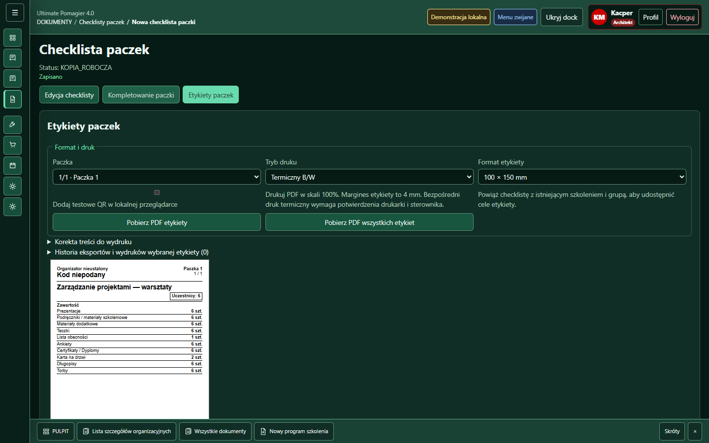 | 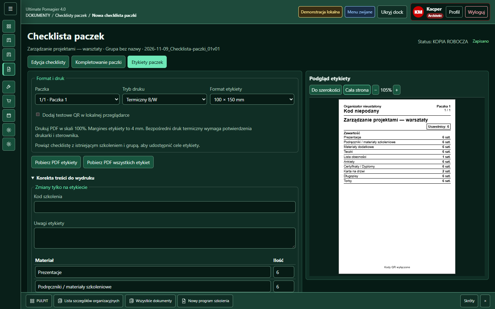 |

## 4. Zmienione pliki i komponenty

- `WidokChecklistPaczek.tsx`: wspólny nagłówek, tabela `Pozycja`, lokalna `KategoriaMaterialow`, układ paczek i formularzy, zwarte kompletowanie. Wspólny opis dyspozycji `opiszDyspozycje` zapobiega rozjazdowi tekstów między wierszem a szczegółami.
- `PodgladWydrukuPaczki.tsx`: jedyny nowy plik komponentu; kontener prezentacyjny z dopasowaniem szerokości i całej strony, przyciskami powiększenia, odczytem skali i obszarem przewijania. Używany przy wydruku checklisty oraz przy etykietach. Nie zawiera logiki dokumentu ani eksportu.
- `PanelEtykietPaczek.tsx`: istniejący wspólny układ formularza i podglądu, tabela korekt, wybór widocznej strony.
- `widokChecklistPaczek.css`, `panelEtykietPaczek.css`: style ograniczone do modułu i nowych lokalnych klas, responsywne przejście do jednej kolumny, podgląd dostępny podczas przewijania na szerokim ekranie.
- `testy/checklistyPaczek.przegladarka.test.mjs`: regresja nowych interakcji, macierz 105 widoków, jawna ścieżka lokalnego Chrome jako opcja środowiskowa; istniejące testy dostosowane do menu i zwijanych szczegółów.
- `testy/checklistaPaczki.regresja.test.ts`: dostosowany kontrakt prezentacji ilości; wydruk zachowuje porównanie ilości, edytor ma teraz dwa nazwane pola.
- `docs/v4/manifest-widokow.json`, `docs/v4/rejestr-widokow.md`: aktualizacja wyłącznie wpisów checklist; wymagana przez test kompletności komponentów V4.
- Ten raport, zrzuty i podsumowanie macierzy.

Nie dodano bibliotek, API, AI ani integracji. Nie zmieniono globalnego design systemu, routingu, uprawnień, modeli danych, źródeł, zapisu, autosave, historii, QR ani kodu renderowania wydruków.

## 5. Weryfikacja

| Kontrola | Wynik |
|---|---|
| `npm test` wraz z `pretest` | PASS, kod 0; dwa historyczne testy checklist są nadal oznaczone przez repozytorium jako SKIP |
| `npm run lint` | PASS, kod 0 |
| `npm run build` | PASS, kod 0; istniejące ostrzeżenie o dużych chunkach |
| `git diff --check` | PASS |
| Pełny `test:checklisty:przegladarka` | 6 PASS, 0 FAIL |
| Ponowna regresja ergonomii po korekcie szerokości kolumn | 1 PASS, 0 FAIL; ponownie cała macierz 105 widoków |

Przeglądarka: rzeczywisty lokalny Chrome, Playwright, osobne profile, lokalny serwer demonstracyjny. Testy nie wymagają internetu ani kont użytkownika.

Zakres interakcji sprawdzonych automatycznie:

1. Edycja nazwy po znakach z zachowaniem fokusu.
2. Ilość wymagana i przygotowana, w tym puste pole oraz powrót do wartości wyliczanej.
3. Dodanie materiału do wskazanej kategorii i usunięcie przez menu.
4. Zmiana kolejności klawiaturą i przeciąganiem, trwałość kolejności po odświeżeniu.
5. Rozwijanie szczegółów Spacją i Enterem; zachowanie rozwinięcia podczas edycji notatki.
6. Potwierdzanie propozycji 30 egzemplarzy, liczenie 0/12/30, osobne potwierdzenie kompletu, cofnięcie gotowości po zmniejszeniu ilości.
7. Dwie niezależne paczki, przełączanie paczek, zachowanie logistyki i historii po identyfikatorach, zdjęcie i zatwierdzenie kompletności.
8. Blokady archiwum, uprawnienia, odmowa zapisu i ponowienie bez utraty formularza.
9. Samodzielna checklista bez szkolenia oraz etykiety szkoleniowe przypisane do właściwej grupy.
10. Tryb kolorowy i termiczny, formaty 100×150, 100×100 oraz własny 125×90 mm.
11. Korekty nazwy i ilości wyłącznie na etykiecie, zachowanie źródłowej nazwy checklisty oraz ponowne otwarcie korekt.
12. Skala podglądu: szerokość, cała strona, powiększanie i pomniejszanie; proporcja etykiety 2:3 w całej macierzy.
13. Pobranie rzeczywistych PDF checklisty, jednej etykiety i wszystkich etykiet; liczba stron i wymiary odczytane przez `pdf-lib`.
14. Testowe QR, trzy cele etykiety, ochrona logowania, właściwa grupa, ponowny wydruk oraz historia eksportów.
15. Odczyt starszych danych, kompresja i quota, ponowne otwarcie zapisanej checklisty; brak nieoczekiwanych błędów JS.
16. Niezmieniona zawartość drzewa wydruku przy przełączeniu edycja–kompletowanie.

Macierz: 1920×1080, 1440×900, 1366×768, 1280×720, 1024×768, 768×1024 i 390×844; każdy rozmiar × 75%, 85%, 100%, 125%, 150% × trzy etapy = 105 kontroli i zrzutów. Skale 75–125% stosowano przez istniejący mechanizm aplikacji. 150% to jawna symulacja CSS zoom, ponieważ aplikacja ogranicza swój zakres do 130%; nie jest to test natywnego zoomu Windows/WebView ani ustawienia menu Chrome.

Zrzuty referencyjne i mobilne obejrzano wizualnie. Automatyczne kontrole całej macierzy sprawdzają szerokości modułu i strony oraz proporcje etykiety; nie zastępują testu z czytnikiem ekranu.

Pełne zrzuty macierzy i logi uruchomień znajdują się lokalnie w ignorowanym `tmp/checklisty-ux/` oraz `tmp/*ux*.log`. Zwięzłe trwałe zestawienie: [macierz weryfikacji](macierz.json).

## 6. Widoki mobilne

Na wąskim ekranie podgląd znajduje się pod formularzem. Tabela edycji przewija się poziomo we własnym obszarze; pola zachowują użyteczne szerokości, a Tab przenosi fokus także do dalszych kolumn. Kompletowanie korzysta z dwóch kolumn i pokazuje ilość wymaganą, liczenie oraz stan bez rozwijania.

| Edycja | Kompletowanie | Etykiety |
|---|---|---|
| 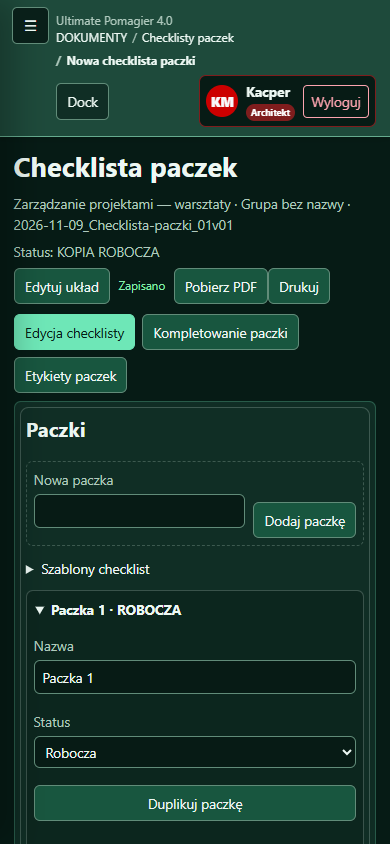 | 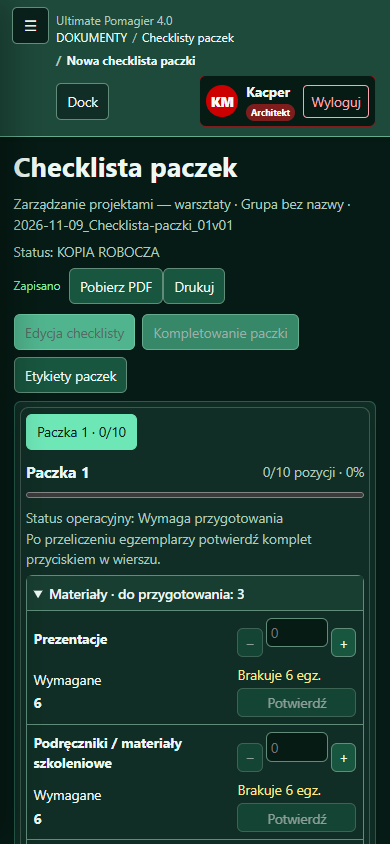 | 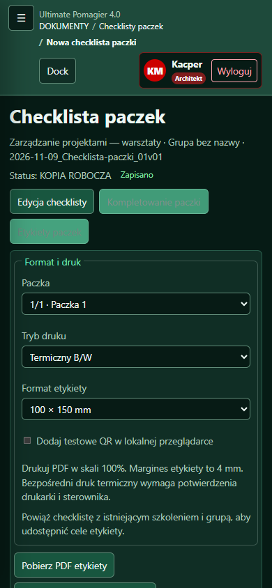 |

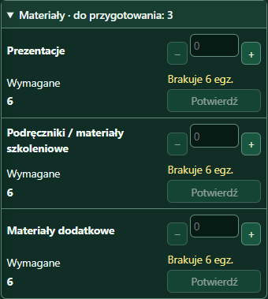

## 7. Pozostałe ograniczenia i ryzyka

- Przy 390 px i 125% globalna strona ma szerokość przewijania 400 px, a w symulacji 150% — 480 px. Identyczny wynik pozostaje po całkowitym wyłączeniu modułu z układu. To ograniczenie globalnej powłoki; moduł nie zwiększa tej szerokości. Zgodnie z zakresem nie zmieniano globalnej nawigacji ani minimalnych wymiarów powłoki. Zatem warunek całkowitego braku poziomego przewijania aplikacji nie jest spełniony w tych dwóch skrajnych ustawieniach.
- W źródłowym szablonie checklisty występuje częściowo przycięty domyślny nagłówek swobodny. Widać go przed i po; nie przeprojektowywano zawartości wydruków.
- Nie testowano fizycznej drukarki termicznej, skanera QR, natywnego okna Windows/Tauri ani czytnika ekranu. PDF i QR były sprawdzane w zakresie istniejących testów modelu i rzeczywistej przeglądarki.
- Długie nazwy w edytowalnym polu przewijają się wewnątrz kontrolki. Przy małej szerokości tabela pozostaje lokalnie przewijalna; jest to zamierzony kompromis zachowujący wygodną edycję liczbową.
- Wrażliwymi miejscami przyszłych regresji są skalowanie otoczenia dokumentu oraz mierzalność niewybranych etykiet dla eksportu zbiorczego. Oba przepływy mają ochronę przeglądarkową i testy rzeczywistych PDF.
- Pierwsze przebiegi wykryły przestarzałe oczekiwanie testu liczby komponentów ilości oraz brak nowego komponentu w rejestrze V4; zostały świadomie zaktualizowane. Test kompletowania wykrył ukrycie tekstów dyspozycji w szczegółach — teksty przywrócono w widocznym wierszu. Końcowe przebiegi przechodzą.

Zmiany pozostają w katalogu roboczym na `main`. HEAD i lokalny `origin/main` nie zostały zmienione. Nie wykonywano commita, pushu ani publikacji wydania.
